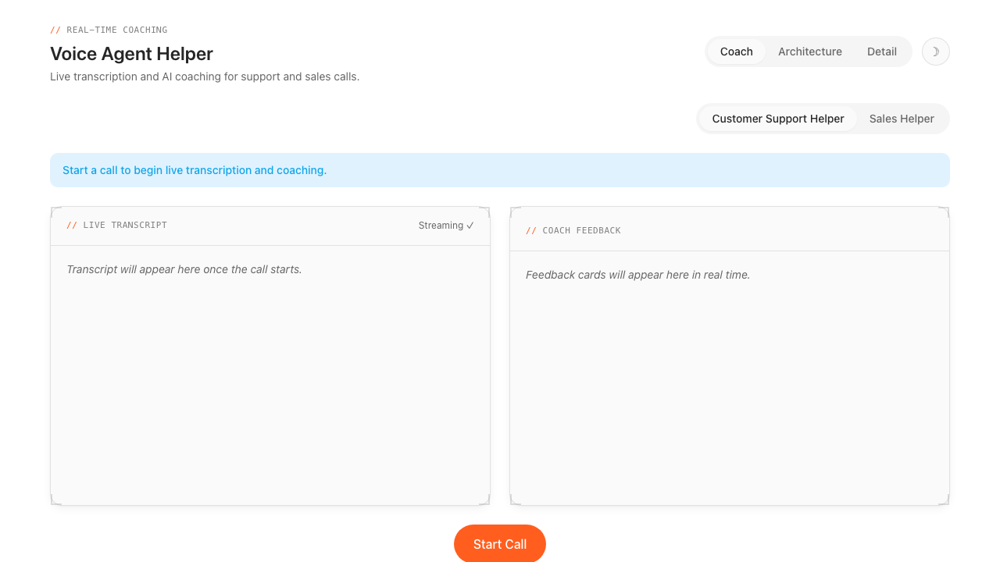

# Voice Agent Helper

[](LICENSE)

> A real-time voice coaching demo built on Cloudflare Workers, Durable
> Objects, and Workers AI — live transcription plus LLM-generated coaching
> feedback for support and sales calls.

> **Status**: This is a reference implementation shared as-is. It is not
> actively maintained; support is best-effort via [GitHub Issues](../../issues).

**[Live Demo](https://voice-agent-helper.dwarven.workers.dev)**



Stream your microphone through Cloudflare's Workers AI speech-to-text, get
live transcription, and receive instant coaching suggestions from an LLM —
all on Cloudflare's edge. Built with the
[Cloudflare Agents SDK](https://developers.cloudflare.com/agents/),
[`@cloudflare/voice`](https://developers.cloudflare.com/agents/models/conversational-ai/),
[Workers AI](https://developers.cloudflare.com/workers-ai/), and React.

## Table of Contents

- [Architecture](#architecture)
- [Features](#features)
- [Tech Stack](#tech-stack)
- [Prerequisites](#prerequisites)
- [Quickstart](#quickstart)
- [Account configuration](#account-configuration)
- [Project structure](#project-structure)
- [Customization](#customization)
- [Cost guards](#cost-guards)
- [Limitations](#limitations)
- [Contributing](#contributing)
- [License](#license)
- [Acknowledgments](#acknowledgments)

## Architecture

```mermaid
graph LR
    Browser["Browser<br/>React SPA"]
    Worker["Worker entry<br/>routeAgentRequest()"]
    RateLimit["Rate limit binding<br/>5 conns / 60s / IP"]
    Agent["HelperAgent<br/>Durable Object"]
    STT["Nova-3 STT<br/>Workers AI"]
    LLM["Llama 3.1 8B<br/>Workers AI"]

    Browser <-- "mic audio · WebSocket" --> Worker
    Worker --> RateLimit
    RateLimit --> Agent
    Agent -- "transcribe" --> STT
    STT -- "transcript" --> Agent
    Agent -- "coaching prompt" --> LLM
    LLM -- "suggestion / insight" --> Agent
    Agent -- "status · feedback · metrics" --> Browser
```



The Worker entry point gates new WebSocket connections through a native
Rate Limiting binding before they ever reach the Durable Object, so a
single caller can't spin up unbounded voice sessions. Everything else runs
inside the `HelperAgent` Durable Object, which orchestrates two independent
Workers AI calls (streaming STT and per-utterance/rolling-window coaching)
and streams every result back over the same WebSocket as typed JSON
messages.

<details>
<summary>Detailed sequence diagram</summary>

```
 ┌──────────────┐      WebSocket       ┌──────────────────────────┐
 │  Browser     │ ◄──────────────────► │  HelperAgent (DO)        │
 │  (React SPA) │                      │                          │
 │              │   mic audio ───────► │  ┌─ Workers AI Nova-3    │
 │  • Transcript│                      │  │  STT (streaming)       │
 │  • Feedback  │   JSON messages      │  │                        │
 │  • VU meter  │ ◄─────────────────── │  ├─ onTranscript()       │
 │  • Detail    │   • status           │  │   └─► LLM (suggestion) │
 │    tab       │   • feedback         │  │                        │
 │              │   • metrics          │  └─ rollingAnalysis()     │
 │              │   • notice           │      └─► LLM (insight)    │
 └──────────────┘                      └──────────────────────────┘
```

1. **Microphone capture** — the browser captures audio and streams it over a WebSocket to a `HelperAgent` Durable Object, gated by a per-IP connection rate limit at the Worker entry point.
2. **Streaming STT** — `@cloudflare/voice` feeds the audio into Workers AI's Nova-3 speech-to-text model, which returns interim and final transcripts.
3. **Per-utterance coaching** — each finalized transcript triggers an LLM call (`@cf/meta/llama-3.1-8b-instruct-fast`) that produces a 1-2 sentence coaching suggestion.
4. **Rolling analysis** — every 20 seconds, the agent sends the last few exchanges to the LLM for a proactive insight.
5. **Latency + quota telemetry** — both pipeline stages are timed and surfaced to the client as `metrics` messages; quota limits (session length, LLM call cap) surface as `notice` messages.

All coaching is displayed in real time alongside the live transcript.

</details>

## Features

- **Live transcription** with interim (partial) results shown as you speak
- **Two coaching modes** — Customer Support and Sales, each with a tailored system prompt
- **Real-time feedback** — per-utterance suggestions + periodic rolling insights
- **Mic level meter** — visual VU meter while listening
- **Detail tab** — the exact pipeline configuration in effect, plus live STT/LLM latency measurements for the current call
- **Cost guards** — a per-IP connection rate limit, a max session duration, and a max LLM-calls-per-session cap, all centrally configured
- **Dark mode** — auto-detects system preference with a manual toggle
- **Kumo design system** — Cloudflare Workers visual language with corner-bracket cards

## Tech Stack

| Layer            | Technology                                                                                                          |
| ---------------- | ------------------------------------------------------------------------------------------------------------------- |
| Client           | React 19, Vite, Tailwind v4 (Kumo design tokens)                                                                    |
| Server           | Cloudflare Workers, Durable Objects, [Agents SDK](https://developers.cloudflare.com/agents/)                        |
| Speech-to-text   | Workers AI — Nova-3 (streaming)                                                                                     |
| Coaching LLM     | Workers AI — Llama 3.1 8B Instruct Fast                                                                             |
| Abuse protection | Workers native [Rate Limiting binding](https://developers.cloudflare.com/workers/runtime-apis/bindings/rate-limit/) |
| Language         | TypeScript throughout (shared client/server message contract)                                                       |
| Testing          | Vitest, Testing Library                                                                                             |

## Prerequisites

- [Node.js](https://nodejs.org/) 18+
- [Wrangler CLI](https://developers.cloudflare.com/workers/wrangler/) (`npm install -g wrangler`)
- A Cloudflare account with [Workers AI](https://developers.cloudflare.com/workers-ai/) enabled

## Quickstart

```bash
# Install dependencies
npm install

# Run the dev server (Vite + Wrangler local dev)
npm run dev

# Run lint + tests + a dry-run build
npm run check

# Deploy to Cloudflare
npm run deploy
```

There are no required environment variables or secrets — the only external
dependency is the `AI` binding (Workers AI), which is configured in
`wrangler.jsonc` and available on any Cloudflare account.

## Account configuration

This project does **not** hardcode an `account_id` in `wrangler.jsonc`. Wrangler resolves your account from your logged-in session or the `CLOUDFLARE_ACCOUNT_ID` environment variable.

To set it explicitly:

```bash
export CLOUDFLARE_ACCOUNT_ID=your-account-id
```

Or add it to `wrangler.jsonc`:

```jsonc
{
  "account_id": "your-account-id",
  // ...
}
```

## Project structure

```
cloudflare-voice-agent-helper/
├── src/
│   ├── client/                    # React SPA (Vite-built, served as static assets)
│   │   ├── components/             # Kumo-styled UI primitives
│   │   │   ├── ArchitecturePanel.tsx  # animated pipeline diagram tab
│   │   │   ├── Badge.tsx
│   │   │   ├── Banner.tsx
│   │   │   ├── Button.tsx
│   │   │   ├── Card.tsx             # supports corner-bracket decoration
│   │   │   ├── DetailPanel.tsx       # config + live latency tab
│   │   │   ├── Eyebrow.tsx          # // MONO LABEL accent
│   │   │   ├── Tabs.tsx
│   │   │   └── index.ts
│   │   ├── lib/
│   │   │   ├── cn.ts                # class name joiner
│   │   │   ├── personas.ts          # client-side persona options
│   │   │   └── useVoiceHelper.ts    # voice client lifecycle hook
│   │   ├── styles/
│   │   │   ├── app.css              # global styles + font stacks
│   │   │   ├── architecture.css     # Architecture-tab animation keyframes
│   │   │   └── kumo-tokens.css      # Kumo design tokens (light + dark)
│   │   ├── App.tsx                  # root component (Coach/Architecture/Detail tabs)
│   │   ├── App.test.tsx
│   │   └── main.tsx                 # React entry point
│   ├── server/                      # Worker + Durable Object
│   │   ├── HelperAgent.ts           # STT → LLM coaching pipeline + quotas + metrics
│   │   ├── index.ts                 # Worker fetch handler + rate limit gate
│   │   └── personas.ts              # server-side persona prompts
│   └── shared/
│       ├── config.ts                # single source of truth: STT/LLM/quota config
│       └── messages.ts              # typed client ⇄ server message contract
├── index.html
├── wrangler.jsonc
├── vite.config.ts
├── tsconfig.json
└── package.json
```

## Customization

### Add a new persona

1. Add an entry to `PERSONAS` in `src/server/personas.ts` with a unique `id`, `label`, `systemPrompt`, and `rubric`.
2. Add a matching option to `PERSONA_OPTIONS` in `src/client/lib/personas.ts`.

The persona is selected via the `?persona=` query param on the WebSocket URL and drives every LLM coaching call.

### Swap the STT or LLM model, or adjust quotas

All pipeline configuration lives in one place: **`src/shared/config.ts`**.
It's imported by both the server (which uses the values to configure the
transcriber, LLM, and quota enforcement) and the client's Detail tab (which
displays them verbatim), so the two can never drift.

- **STT**: edit `STT_CONFIG` — see [Workers AI STT docs](https://developers.cloudflare.com/workers-ai/models/#speech-to-text).
- **LLM**: edit `LLM_CONFIG.model` — see [Workers AI text generation docs](https://developers.cloudflare.com/workers-ai/models/#text-generation).
- **Rolling analysis interval**: `LLM_CONFIG.rollingAnalysisIntervalSeconds`.
- **Quotas**: `QUOTA_CONFIG` (see [Cost guards](#cost-guards) below).

## Cost guards

Three quotas bound worst-case Workers AI spend from a single caller,
configured in `src/shared/config.ts` (`QUOTA_CONFIG`):

1. **Connection rate limit** — a native Workers [Rate Limiting binding](https://developers.cloudflare.com/workers/runtime-apis/bindings/rate-limit/) gates new WebSocket upgrades in `src/server/index.ts`, keyed by `cf-connecting-ip`, before the request ever reaches the Durable Object. This is a coarse abuse backstop, not a precise per-user fairness guarantee — the docs advise against IP-based keys for that reason, but for an unauthenticated public demo it's the only actor signal available.
2. **Max session duration** — `HelperAgent` schedules a one-shot task on call start that auto-ends the call once it exceeds `QUOTA_CONFIG.maxSessionSeconds`.
3. **Max LLM calls per session** — once a session's coaching calls hit `QUOTA_CONFIG.maxLlmCallsPerSession`, further LLM calls are skipped (transcription keeps running) and the client receives a one-time notice.

Both quota events are typed `notice` messages in `src/shared/messages.ts`,
and the Detail tab shows the exact configured values alongside live STT/LLM
latency for the current call.

## Limitations

- **Single stream** — one microphone per browser tab; not designed for multi-participant calls.
- **No TTS** — coaching is displayed as text only; there is no text-to-speech output.
- **Hibernation** — the Durable Object uses WebSocket Hibernation. Per-call state is reset on each new connection, so coaching history does not persist across reconnections.
- **STT latency is an approximation** — Workers AI's streaming transcriber doesn't expose an internal model-only timing, so the Detail tab's STT metric measures _finalization lag_ (last interim update → finalized utterance), not a pure model benchmark. See the doc comment on `HelperAgent.createTranscriber`.
- **Browser support** — requires a browser with `AudioWorklet` and `WebSocket` support (all modern evergreen browsers).

## Contributing

Contributions are welcome. Please read the [Contributing Guide](CONTRIBUTING.md) for details on our code of conduct and the process for submitting pull requests.

## License

This project is licensed under the MIT License. See the [LICENSE](LICENSE) file for details.

## Acknowledgments

- Built on the [Cloudflare Agents SDK](https://developers.cloudflare.com/agents/) and [`@cloudflare/voice`](https://developers.cloudflare.com/agents/models/conversational-ai/)
- Speech-to-text and coaching inference powered by [Workers AI](https://developers.cloudflare.com/workers-ai/)
- Visual language based on Cloudflare's Kumo design system
